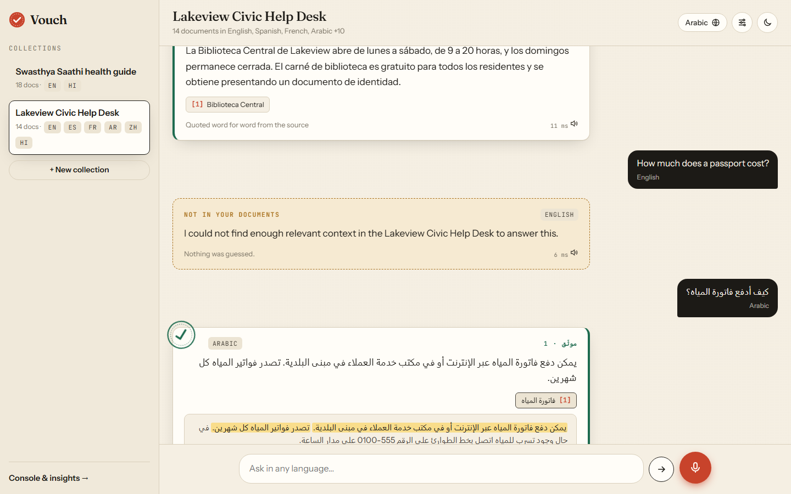
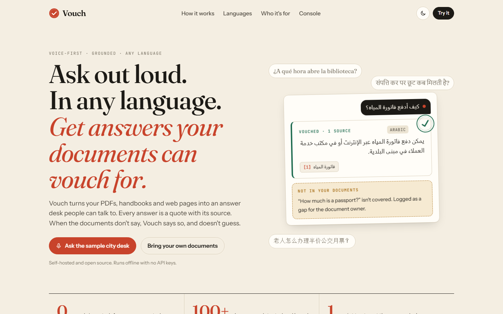
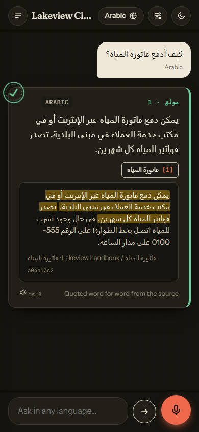
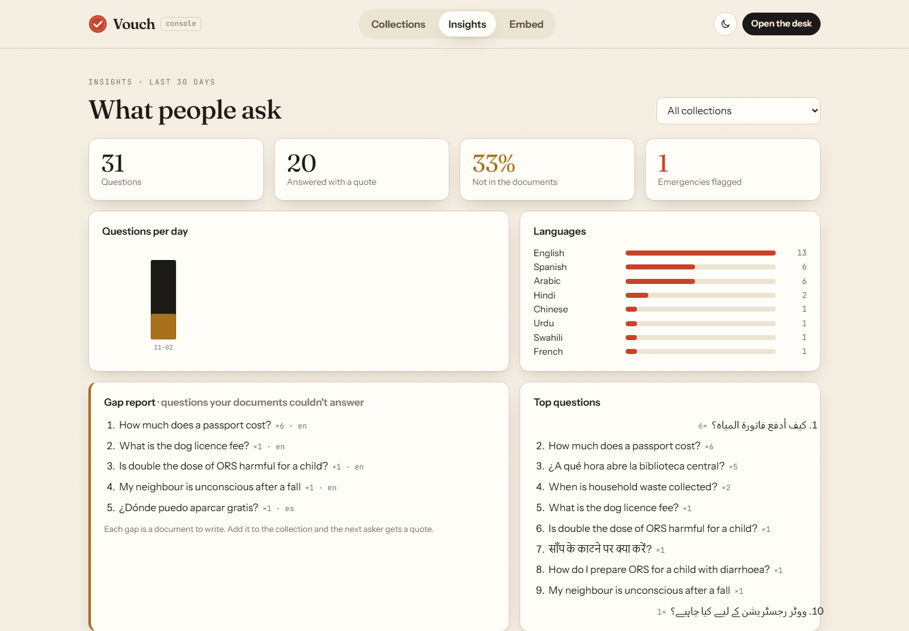

# Vouch

**Ask out loud, in any language. Get answers your documents can vouch for, or an honest "not in your documents".**

[](https://github.com/MrNK2107/voice-rag/actions/workflows/ci.yml)


Vouch is a voice-first answer desk over your own documents. Upload PDFs, text, Markdown, HTML or a web page into a named collection, then ask by voice or text in any language. Every answer is a sentence quoted from your documents, with its source one tap away. When nothing in the documents answers the question, Vouch says so instead of guessing, and the question lands in a gap report for whoever owns the documents.



| Landing page | Phone, Arabic, dark theme | Console: insights and gap report |
|---|---|---|
|  |  |  |

`voice-rag` is the repository and Python package name; Vouch is the product. Product brief (users, pricing, roadmap): [`docs/PRODUCT.md`](docs/PRODUCT.md). 60-second demo: [`docs/DEMO.md`](docs/DEMO.md).

---

## Why Vouch

| | Generic chatbot | Vouch |
|---|---|---|
| Where answers come from | whatever the model remembers | a sentence quoted from your document, checked against the cited passage |
| When it doesn't know | answers anyway | "not in your documents", logged as a gap |
| Asking in Tamil, Arabic or Swahili | often replies in English | system messages in your language; the quote keeps its source language, labelled |
| Voice | an add-on | the main way in: browser, Sarvam or Whisper |
| Emergencies | a paragraph of advice | a call-for-help banner in your language |

---

## Quickstart

One command, fully offline (no API key, no Qdrant server, no model download):

```bash
python -m pip install -r requirements-demo.txt
python -m app --demo            # http://localhost:8000  (desk: /app, console: /admin)
```

The demo starts with two sample collections: **Lakeview Civic Help Desk** (a fictional city's handbook, one passage in each of 14 languages) and the **Swasthya Saathi health guide** (Hindi/English public-health passages from the project's origin). Create your own collection from the sidebar or the console and drop in files; in demo mode they are kept in a temp directory.

With Docker: `docker compose up --build demo`.

**With your own documents, persistently.** This loads the multilingual embedder (`intfloat/multilingual-e5-small`, about 470 MB, downloaded once) and stores collections in `storage/collections/`:

```bash
python -m pip install -r requirements.txt
cp .env.example .env            # optional: SARVAM_API_KEY, WHISPER_API_BASE/KEY, ADMIN_TOKEN
python -m app                   # or: python -m uvicorn app.main:app --port 8000
```

Use `python -m ...` rather than the bare `uvicorn` launcher; some locked-down Windows machines block console-script launchers.

---

## Features

**Collections.** Named collections of your documents. PDFs are split per page so citations name the page; HTML is stripped of navigation and scripts; Markdown is flattened; URLs are fetched with a private-address (SSRF) guard, a 5 MB cap and checked redirects. Each document's language is detected at ingest. Manage them in the console (`/admin`) or the API.

**Voice, in any language.** Three ways to hear the question, chosen per request (`app/stt.py`):

| Provider | Languages | Needs |
|---|---|---|
| Browser (Web Speech API) | whatever the browser supports | nothing; audio never reaches the server |
| Sarvam `saarika` | Hindi, Bengali, Tamil, Telugu, Kannada, Malayalam, Marathi, Gujarati, Punjabi, Odia, English | `SARVAM_API_KEY` |
| Whisper, OpenAI-compatible API | ~100 languages, auto-detected | `WHISPER_API_BASE` (+ key, or a local whisper.cpp / faster-whisper server) |
| Local faster-whisper | ~100 languages | `pip install faster-whisper` (optional) |

`STT_PROVIDER=auto` sends an Indian-language hint to Sarvam and everything else to Whisper, then falls back to the browser. Answers can be read aloud with the browser's speech synthesis.

**Language handling.** `app/langid.py` detects the question's language from its script (Devanagari, Tamil, Bengali, Arabic vs Urdu vs Persian, Hebrew, Han, kana, Hangul, Cyrillic, Greek, Thai, Ethiopic and more) and, for Latin script, from function words and telltale letters (Spanish, French, German, Portuguese, Italian, Dutch, Swahili, Indonesian, Turkish, Vietnamese, romanised Hindi...). No model, no download. Then:

- abstentions, safety refusals and emergency advice are written in the asker's language (`app/i18n.py`, 23 languages, English fallback);
- the interface renders Arabic, Urdu, Persian and Hebrew right-to-left, per message;
- Chinese, Japanese and Thai are tokenised into character bigrams and chunked by sentence, since they have no spaces (`app/textutil.py`);
- retrieval uses a multilingual embedder by default, so a question can find a passage written in another language. The quote stays in the passage's language and is labelled; set `TRANSLATE_ANSWERS=true` with an OpenAI-compatible endpoint to translate it after every check has passed, with the original kept alongside.

**Receipts, not paraphrase.** Hybrid retrieval (Qdrant dense vectors plus SQLite FTS5 BM25, fused with reciprocal rank fusion and diversity caps), then an extractive answer: the best sentences from one source. Before anything is returned, a grounding check, a strict per-sentence citation check against the cited passage, an optional query-coverage gate and an output guard must all pass. Citation chips open the source passage with the quoted sentences highlighted.

**Honest abstention.** Off-topic questions (retrieval margin), on-topic questions the documents don't answer (coverage gate), and anything that fails a check get a clear "not in your documents". No LLM writes the answer, so there is nothing to hallucinate.

**Safety.** A prompt-injection guard screens every question: normalisation (homoglyphs, zero-width characters, leetspeak, encoded payloads) plus patterns in English, Hindi, Hinglish, Tamil, Tanglish and, new in Vouch, Spanish, French, German, Portuguese, Italian, Indonesian, Turkish, Swahili, Russian, Ukrainian, Chinese, Japanese, Korean, Arabic, Urdu and Persian. A small learned classifier adds recall for the languages it was trained on. Retrieved passages are scanned too, so a poisoned document is quarantined. An emergency red-flag check (unconscious, not breathing, chest pain, heavy bleeding, seizure, snake bite, poisoning...) in 23 languages adds a call-for-help banner. Details and measured limits: [`GUARDRAILS.md`](GUARDRAILS.md).

**Embeddable widget.** One script tag puts a Vouch button on any website, scoped to one collection:

```html
<script src="https://your-vouch-host/widget.js" data-collection="city-desk"
        data-label="Ask the city" data-color="#c8432b" data-position="right" defer></script>
```

The console's Embed tab generates the snippet with a live preview. Each collection also has a share link: `/embed/<collection>`.

**Insights and the gap report.** Every question is logged (collection, language, answered/abstained/blocked, channel, latency) in SQLite. The console shows questions per day, abstention rate, languages, emergencies, top questions, and the gap report: questions the documents couldn't answer, most frequent first. Turn it off with `ANALYTICS_ENABLED=false`.

---

## How it works

```txt
 voice ──> browser Web Speech ───────────────┐
 voice ──> /api/ask-audio ─> STT router ─────┤  Sarvam (Indian langs) | Whisper (any) | local faster-whisper
 text  ──> /api/ask-text ────────────────────┤
                                             v
                                   language detection (script + function words)
                                             v
                                   input guard  (patterns in 21 languages + learned classifier)
                                             v
            collection ──> hybrid retrieval: Qdrant dense (multilingual e5) + SQLite FTS5 (BM25, CJK bigrams)
                                             v   reciprocal rank fusion, diversity caps
                                   passage injection scan -> retrieval confidence (margin) guard
                                             v
                                   extractive answer (best sentences from one source)
                                             v
                                   grounding + query coverage + strict citation + output guard
                                             v
                     (optional) translate the verified quote into the asker's language
                                             v
             localised messages, RTL hint, emergency triage, question log -> JSON + web UI
```

The pipeline lives in `app/harness.py`; each stage is timed and returned in `timings_ms`.

---

## API

| Method | Path | What it does |
|---|---|---|
| `POST` | `/api/ask-text` | `{"query", "collection"?, "language"?}` -> answer, citations (with passage, source, page), `language`, `rtl`, `answer_language`, `advisory`, timings |
| `POST` | `/api/ask-audio` | multipart `file` + `collection`, `language`, `stt` (provider) -> same response plus `transcript`, `stt_provider` |
| `GET` | `/api/collections` | list collections with document counts and languages |
| `POST` | `/api/collections` | `{"name", "title", "description"}` |
| `GET` / `DELETE` | `/api/collections/{name}` | details and document list / delete |
| `POST` | `/api/collections/{name}/files` | multipart `files` (PDF, TXT, MD, HTML) |
| `POST` | `/api/collections/{name}/text` | `{"text", "title"}` |
| `POST` | `/api/collections/{name}/url` | `{"url"}` |
| `GET` | `/api/insights?collection=&days=` | volume, abstention rate, languages, top questions, gaps |
| `POST` | `/api/detect-language` | `{"text"}` -> code, name, script, rtl |
| `GET` | `/api/config` | STT providers available, languages, sample questions |
| `POST` | `/api/agent` | the health demo's tool-using agent loop (see [Origins](#origins)) |

Pages: `/` landing, `/app` desk, `/admin` console, `/embed/{collection}` widget frame, `/widget.js`, `/demo/health` the original health demo, `/docs` OpenAPI. If `ADMIN_TOKEN` is set, collection changes and insights need the `X-Admin-Token` header.

---

## Configuration

All settings are environment variables (or `.env`); see [`.env.example`](.env.example). The main ones:

| Variable | Default | Meaning |
|---|---|---|
| `VOUCH_DEMO` / `VOICE_RAG_DEMO` | off | offline sample collections, hashing embedder, in-memory store |
| `EMBED_MODEL` | `intfloat/multilingual-e5-small` | any SentenceTransformer; `BAAI/bge-m3` for stronger cross-language retrieval |
| `VOUCH_COLLECTIONS_DIR` | `storage/collections` | where collections (Qdrant embedded + FTS5) live |
| `STT_PROVIDER` | `auto` | `auto`, `sarvam`, `whisper_api`, `faster_whisper` |
| `SARVAM_API_KEY`, `WHISPER_API_BASE`, `WHISPER_API_KEY` | empty | speech-to-text providers |
| `TRANSLATE_ANSWERS`, `TRANSLATE_API_BASE`, `TRANSLATE_MODEL` | off | translate verified quotes |
| `EMERGENCY_TRIAGE` | `true` | red-flag advisory banner |
| `ADMIN_TOKEN` | empty | protect collection writes and insights |
| `ANALYTICS_ENABLED`, `VOUCH_ANALYTICS_PATH` | `true`, `storage/analytics.sqlite` | question log |
| `MIN_DENSE_SCORE`, `MIN_DENSE_MARGIN`, `MIN_QUERY_COVERAGE` | 0.50, 0.055, 0 | abstention thresholds (calibrated for e5; see Benchmarks) |

---

## Deploy

- **Docker, offline demo:** `docker build -f Dockerfile.demo -t vouch-demo . && docker run -p 8000:8000 vouch-demo`
- **Hugging Face Spaces:** the repo is a Space as-is (`sdk: gradio`, `python app.py` on port 7860). `app.py` serves the same API and pages on a Gradio `Server`. Set `VOUCH_DEMO=1` for an instant public demo, or leave it unset for the e5 + Qdrant production harness.
- **A VM:** `python -m app --host 0.0.0.0` behind a reverse proxy with TLS, `ADMIN_TOKEN` set, and `storage/` on a persistent disk.

More, including the Git LFS note for the classifier weights: [`docs/DEPLOY.md`](docs/DEPLOY.md).

> The learned injection classifier (`app/models/injection_clf.npz`) is stored with **Git LFS**. Run `git lfs pull` after cloning; without it the guard logs a warning and falls back to patterns only.

---

## Testing

The suite runs fully offline: a fake STT, a deterministic hashing embedder with the SentenceTransformer API, in-memory Qdrant, and the real SQLite FTS5 schema. `requests.post` is blocked.

```bash
python -m pip install -r requirements-dev.txt   # no torch / gradio / datasets
python -m pytest -q                             # 459 tests, about 12 s
```

New with Vouch: `tests/test_multilingual.py` (language detection on 21 scripts and languages, RTL hints, CJK tokenisation and sentence splitting, injection patterns and benign look-alikes in 12 languages, localised emergency triage, answering in 9 languages from the sample collection, translation hook) and `tests/test_collections_api.py` (collection lifecycle, Spanish and Chinese ingestion, PDF/HTML/Markdown extraction, URL fetching and the SSRF guard, STT provider selection, Whisper request format, insights and gap report, the full HTTP API, admin token, pages and widget). The earlier suites cover retrieval ranking, guards, the learned classifier, citations, answerability, edge cases, the health demo and its agent.

The offline embedder does not match across languages (a Spanish question only finds Spanish passages); the multilingual e5 model does, but it is not downloaded in tests.

---

## Benchmarks (MSMARCO-XI)

These numbers come from the project's first life as a solution to HH Goa 2026 Task 2: grounded voice QA over [`ai4bharat/MSMARCO-XI`](https://huggingface.co/datasets/ai4bharat/MSMARCO-XI) (Hindi, validation split). They measure the same retrieval and answer pipeline Vouch uses, on that dataset. They were not re-run for the multilingual changes, and the MSMARCO index is not in the repository.

**Latency, real index** (4,751 chunks from 400 rows; 30 queries: 15 from the indexed corpus, 15 off-topic, unsafe or prompt injections):

| Stage | P50 (ms) | P70 (ms) | P100 (ms) |
| :--- | ---: | ---: | ---: |
| Input guardrails | 0.03 | 0.03 | 0.04 |
| Dense + lexical search (Qdrant + SQLite FTS5) | 37.13 | 49.47 | 108.09 |
| Retrieval guard | 0.00 | 0.00 | 0.01 |
| Extractive answer | 0.47 | 0.80 | 1.77 |
| Grounding check | 0.07 | 0.08 | 0.28 |
| **Post-STT total** | **36.65** | **46.75** | **108.8** |
| Cloud STT (Sarvam), measured live | ~1226 | | |

A later run on the same 30 queries (`storage/benchmark_results.json`) gave a post-STT P50 of 11.68 ms and P100 of 19.92 ms. Input-guard latency rose to about 0.27 ms P50 after the learned classifier was added (1 Nov 2026).

**Decisions:** 29/30 (96.7%) correct answer-vs-abstain decisions. All 15 off-topic, unsafe and injection queries abstained; 14/15 corpus queries got grounded answers; the miss was a false abstention, not a wrong answer.

**Offline micro-benchmark** (`python scripts/benchmark_offline.py --repeats 30 --markdown`; 12-document sample corpus, hashing embedder, so it measures pipeline overhead, not e5 encoding): post-STT p50 2.5 ms, p95 4.1 ms; hit@1 and hit@3 100% on 12 answerable queries; decision accuracy 100% on 16. The corpus is tiny and well separated: a smoke check, not a quality claim.

**Injection guard, held-out sets** (40 attacks, 40 benign look-alikes, never used for training; `python scripts/eval_guards.py`). These sets cover English, Hindi, Hinglish, Tamil and Tanglish only; the new world-language patterns are tested in `tests/test_multilingual.py` but have no held-out evaluation yet.

| Language | Attacks | Patterns alone | Patterns OR classifier | False negatives | Benign | False positives |
|---|---:|---:|---:|---:|---:|---:|
| English | 20 | 1 | 12 | 8 | 24 | 0 |
| Hindi | 5 | 3 | 4 | 1 | 4 | 0 |
| Hinglish | 3 | 1 | 1 | 2 | 3 | 0 |
| Tamil | 6 | 0 | 5 | 1 | 5 | 1 |
| Tanglish | 5 | 2 | 5 | 0 | 4 | 0 |
| Encoded (Hindi in double base64) | 1 | 1 | 1 | 0 | 0 | 0 |
| **Total** | **40** | **8** | **28** | **12** | **40** | **1** |

The sets are small and share an author with the training data, so treat 28/40 as optimistic. Misses and their scores: [`GUARDRAILS.md`](GUARDRAILS.md#error-analysis-of-the-held-out-sets-2026-11-01).

**Answerability on the health collection** (`python scripts/eval_answerability.py`): with the query-coverage gate at 0.6, the dev set answers 19/20 answerable questions and abstains on 17/21 on-topic but unanswerable ones; the held-out set (written after the rule was frozen, run once) answers 11/14 and abstains on 14/16. With the gate off: 19/20, 7/21, 11/14, 9/16. The gate is calibrated only for the offline demo; it is off by default.

---

## Honest limits

- Answers are copied sentences. A Spanish question over English documents gets an English quote (labelled) unless translation is configured.
- Language detection is a heuristic. Very short Latin-script questions ("ok?") fall back to English; Marathi and Nepali are reported as Hindi; Chinese is not split into Simplified vs Traditional.
- The abstention thresholds were calibrated for e5 on MSMARCO-XI and for the hashing embedder on the demo corpora. A new embedder or a very different collection may need `MIN_DENSE_SCORE` / `MIN_DENSE_MARGIN` re-checked.
- The world-language injection patterns and the emergency keywords were written for this release and have no independent evaluation. The system messages in 23 languages need native-speaker review.
- The console has no user accounts: use `ADMIN_TOKEN` and a reverse proxy, or keep it on a private network.
- Insights store question text. That is the point of the gap report, but tell your users, or turn it off.

---

## Origins

Vouch started as a hackathon entry for HH Goa 2026 Task 2 (low-latency grounded voice QA over MSMARCO-XI), then became **Swasthya Saathi**, a Hindi/English health Q&A demo for frontline workers with red-flag triage and a tool-using agent loop. Both live on as presets: the health collection in demo mode, the original page at `/demo/health`, the agent at `POST /api/agent`, and the scripted check `python scripts/demo.py --check`. Write-ups: [`docs/HACKATHON_SUBMISSION.md`](docs/HACKATHON_SUBMISSION.md), [`docs/DEMO_SCRIPT.md`](docs/DEMO_SCRIPT.md), [`CHUNKING.md`](CHUNKING.md), [`LATENCY.md`](LATENCY.md). To rebuild the MSMARCO-XI index: `python scripts/build_index.py --languages hin --max-rows 500`, then `python scripts/benchmark.py --num-queries 30`.

---

## Project structure

```txt
voice-rag/
  app/
    main.py              # FastAPI app: API, pages, widget
    __main__.py          # python -m app [--demo]
    harness.py           # the answer pipeline (guards, retrieval, extraction, checks, language, triage, log)
    collection_store.py  # named collections: Qdrant + FTS5 per collection, metadata
    ingest.py            # PDF / text / Markdown / HTML / URL extraction, SSRF guard
    langid.py            # script + function-word language detection, RTL
    textutil.py          # script-aware tokeniser (CJK bigrams) and sentence splitter
    i18n.py              # system messages in 23 languages
    triage.py            # emergency red flags in 23 languages
    stt.py, stt_sarvam.py# STT providers and selection
    translate.py         # optional translation of verified quotes
    analytics.py         # question log, insights, gap report
    retriever.py         # Qdrant dense + SQLite FTS5, RRF, confidence margin
    generator.py         # extractive answers, query coverage
    guardrails.py, safety.py, injection_clf.py, citations.py
    samples.py           # Lakeview Civic Help Desk sample collection (14 languages)
    demo.py, agent.py    # health preset, scripted demo, agent loop
    offline.py           # offline stand-ins for tests and the demo
    chunking.py, dataset_loader.py, latency.py, config.py, schemas.py
    models/injection_clf.npz   # Git LFS
  web/
    index.html, landing.css    # landing page
    app.html, app.css, app.js  # the desk (also used by embed.html)
    admin.html, admin.css, admin.js   # console: collections, insights, embed
    widget.js, embed.html      # embeddable widget
    styles.css                 # design tokens and shared components
    health-demo.html           # the original health demo page
  scripts/                 # demo, evals, benchmarks, index building, classifier training
  tests/                   # offline pytest suite; tests/data/ holds the labelled sets
  docs/                    # PRODUCT.md, DEMO.md, DEPLOY.md, screenshots/, hackathon write-ups
  app.py                   # Hugging Face Spaces entry
  Dockerfile, Dockerfile.demo, docker-compose.yml
  requirements.txt, requirements-demo.txt, requirements-dev.txt
```
